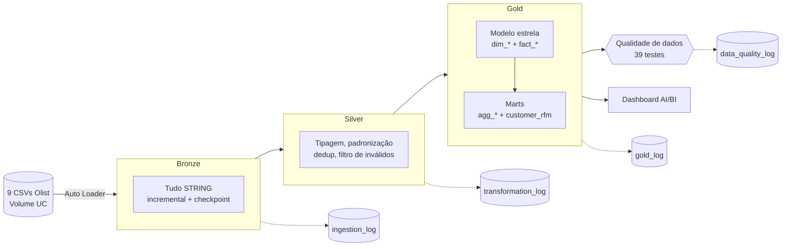
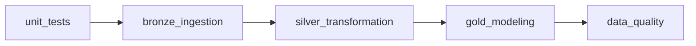
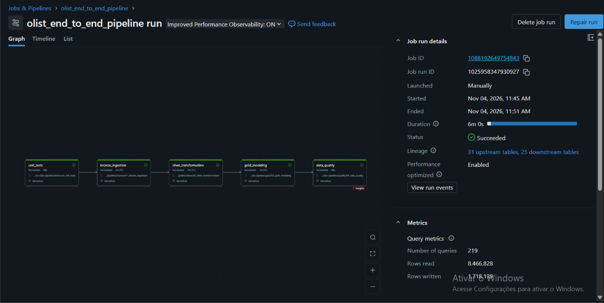

# End-to-End Data Pipeline — Olist E-commerce

Pipeline de Engenharia de Dados ponta a ponta no **Databricks**, com **Delta Lake**, **Unity Catalog** e **Arquitetura Medalhão** (Bronze → Silver → Gold), usando o dataset público de e-commerce brasileiro da [Olist](https://www.kaggle.com/datasets/olistbr/brazilian-ecommerce) (~100 mil pedidos, 2016–2018).

O projeto cobre ingestão incremental, limpeza e padronização, modelagem dimensional, testes automatizados de qualidade, orquestração e um dashboard executivo.

---

## Arquitetura



Orquestração: **Databricks Job** `olist_end_to_end_pipeline` (serverless), uma task por etapa, cada uma dependente da anterior:



Se qualquer etapa falhar, as seguintes não rodam e o Job envia um e-mail de falha.

Execução completa do Job (serverless, ~6 min):



---

## Estrutura do repositório

| Caminho | Conteúdo |
|---|---|
| `bronze/01_bronze_ingestion` | Ingestão incremental dos 9 CSVs com Auto Loader (`availableNow`) |
| `silver/00_silver_profiling` | Perfilamento exploratório da Bronze (nulos, duplicados, formatos) |
| `silver/02_silver_transformation` | Limpeza, tipagem, padronização e deduplicação |
| `gold/03_gold_modeling` | Modelo dimensional (estrela) + marts de negócio |
| `quality/04_data_quality` | 39 testes automatizados de qualidade (bronze, silver, gold, reconciliação) |
| `src/olist_utils.py` | Funções reutilizáveis de limpeza, padronização e dedup (usadas pela Silver e pela Gold) |
| `tests/` | Testes unitários (pytest) das funções de `src/`, e o notebook `run_unit_tests` que os executa |
| `dashboards/*.lvdash.json` | Dashboard AI/BI com 2 páginas (executivo e operação) |
| `jobs/olist_pipeline_job.json` | Definição do Job (pode ser recriado com `databricks jobs create --json @jobs/olist_pipeline_job.json`) |

---

## Camadas

### Bronze — `workspace.bronze`
Dado **como chegou**: todas as colunas como `STRING`, mais metadados de linhagem (`_source_file`, `_ingestion_timestamp`) e `_rescued_data` (valores fora do schema).

- **Auto Loader** com checkpoint por tabela: só lê arquivos novos, então rodar de novo resulta em `+0` linhas.
- Evolução de schema (`addNewColumns`), `multiLine` para as reviews (texto com quebra de linha).
- Log por execução em `bronze.ingestion_log`.

### Silver — `workspace.silver`
Dado **confiável e tipado**:

- `try_cast` para INT / DECIMAL(10,2) / TIMESTAMP: valor inválido vira NULL sem quebrar o job.
- Texto: `trim`, vazio → NULL, cidade minúscula sem acento, UF maiúscula, CEP com 5 dígitos.
- Deduplicação por chave de negócio (fica o registro mais recente da Bronze).
- Remoção de inválidos: chave nula, preço ≤ 0, nota fora de 1–5, coordenadas fora do Brasil.
- Tradução da categoria de produto (PT → EN).
- Recarga completa (`overwrite`), idempotente. Log em `silver.transformation_log`.

### Gold — `workspace.gold`
Dado **pronto para o negócio**: regras de negócio aplicadas e modelo dimensional.

**Modelo estrela**

| Tabela | Grão | Destaques |
|---|---|---|
| `dim_customers` | 1 `customer_id` | região (IBGE), lat/lng média do CEP, `customer_unique_id` |
| `dim_sellers` | 1 vendedor | região, lat/lng |
| `dim_products` | 1 produto | categoria PT/EN, cubagem (cm³), faixa de peso |
| `dim_date` | 1 dia | `date_key` (yyyyMMdd), mês/trimestre, dia da semana, fim de semana |
| `fact_order_items` | 1 item | preço, frete, `is_seller_late` (despacho após o prazo do vendedor) |
| `fact_orders` | 1 pedido | GMV, pagamento, parcelas, prazos de entrega, `is_late`, nota da review |

```
            dim_date
               │ purchase_date_key
dim_customers ─┤
   customer_id │
            fact_orders ──── order_id ──── fact_order_items ─┬─ product_id → dim_products
                                                             └─ seller_id  → dim_sellers
```

**Marts**

| Tabela | Pergunta que responde |
|---|---|
| `agg_sales_monthly` | Como evoluem GMV, pedidos, ticket, nota e atraso mês a mês? (com crescimento MoM) |
| `agg_category_performance` | Quais categorias geram mais receita, e com qual satisfação e peso de frete? |
| `agg_seller_performance` | Quais vendedores vendem mais, e quais atrasam o despacho? |
| `agg_state_performance` | Como variam ticket, frete, prazo e atraso por UF/região? |
| `agg_payment_methods` | Qual a participação de cada forma de pagamento e o parcelamento médio? |
| `customer_rfm` | Segmentação RFM de clientes (Campeões, Fiéis, Em risco, Perdidos…) |

**Regras de negócio principais**
- **Venda válida**: `order_status` diferente de `canceled` e `unavailable` (`is_valid_sale`).
- **GMV do pedido**: soma de preço + frete dos itens.
- **Atraso**: data de entrega ao cliente posterior à data estimada (comparação por dia). Pedido não entregue fica `NULL`.
- **Review**: quando o pedido tem mais de uma, vale a mais recente.
- **RFM**: recência em quintis, a partir do dia seguinte à última compra do dataset. A frequência usa faixas fixas, porque cerca de 97% dos clientes compram uma única vez. O valor monetário também é dividido em quintis.

---

## Qualidade de dados

`quality/04_data_quality` executa **39 testes**, e cada um conta violações (0 = passou):

| Tipo | Exemplos |
|---|---|
| Duplicação na Bronze | nº de linhas = nº de chaves distintas; 1 arquivo de origem por tabela |
| Unicidade (PK) | chaves das tabelas Silver e de todas as dim/fact da Gold |
| Integridade (FK) | nenhum fato aponta para dimensão inexistente |
| Reconciliação | Silver ↔ Gold com o mesmo nº de pedidos/itens/clientes e a mesma receita; mart mensal = fato |
| Regra de negócio | preço > 0, nota entre 1 e 5, compra sempre com data, valor do pedido ≥ 0 |
| Saúde do pipeline | a última execução de cada tabela na Silver terminou com `SUCCESS` |

- **ERROR** quebra o job (e dispara e-mail de falha). **WARN** só fica registrado.
- Resultados históricos em `gold.data_quality_log` e na página "Logística e clientes" do dashboard.

Avisos conhecidos (limitações do próprio dataset Olist, não do pipeline):
- 8 pedidos válidos sem itens.
- ~1 mil pedidos em que o valor pago difere de itens + frete em mais de R$ 1 (juros de parcelamento, vouchers).
- ~280 clientes com CEP sem coordenada na tabela de geolocalização.

### Testes unitários

Além dos testes sobre os dados, as funções de limpeza ficam em `src/olist_utils.py` e têm testes unitários com **pytest** em `tests/test_olist_utils.py`. Cada teste monta um DataFrame pequeno, aplica uma função e confere o resultado:

| Teste | O que garante |
|---|---|
| `fix_header` | remove o BOM do nome da 1ª coluna |
| `clean_strings` | `trim` e texto vazio → `NULL` |
| casts (`to_int`, `to_dec`, `to_ts`) | valor inválido vira `NULL` em vez de quebrar |
| `norm_city`, `norm_state`, `norm_zip` | cidade sem acento, UF maiúscula, CEP com 5 dígitos |
| `dedup` | fica 1 linha por chave, a mais recente |
| `region_case` | UF → região do IBGE |

Os testes são a **1ª etapa do Job** (`tests/run_unit_tests`): se uma função quebrar, o pipeline nem começa.

---

## Principais números (Gold)

| Métrica | Valor |
|---|---|
| Pedidos válidos | 98.207 |
| GMV | R$ 15,7 mi |
| Ticket médio | R$ 160,23 |
| Clientes únicos | 94.990 |
| Nota média | 4,12 / 5 |
| Entregas atrasadas | 6,8% |

**Principal insight:** pedidos entregues no prazo têm nota média **4,29**, e os atrasados, **2,27**. Atraso logístico é o maior detrator de satisfação. O pico de atraso aparece em nov/2017 (Black Friday) e em fev–mar/2018.

---

## Como executar

1. Suba os 9 CSVs do Olist em `/Volumes/workspace/bronze/raw_files/archive/`.
2. Rode o Job **`olist_end_to_end_pipeline`** (Workflows → Jobs → Run now). Ele vem com um agendamento diário às 06:00 (America/Sao_Paulo), **pausado** por padrão.
3. Para recriar o Job em outro workspace:
   ```bash
   databricks jobs create --json @jobs/olist_pipeline_job.json
   ```
   Troque `<seu-usuario>` pelo seu usuário nos caminhos dos notebooks e `seu-email@exemplo.com` pelo e-mail que vai receber as falhas.

**Idempotência:** todas as camadas podem ser reexecutadas sem duplicar dados. A Bronze é incremental via checkpoint; a Silver e a Gold fazem recarga completa.

### Parâmetros

Todos os notebooks leem o catálogo de um widget, em vez de ter `workspace` escrito no código. Assim o mesmo código roda em ambientes diferentes (por exemplo, `dev` e `prod`):

| Parâmetro | Onde | Padrão | Para que serve |
|---|---|---|---|
| `catalog` | todos os notebooks (parâmetro do Job) | `workspace` | catálogo do Unity Catalog usado em todas as camadas |
| `reset_bronze` | `01_bronze_ingestion` | `false` | apaga as tabelas e os checkpoints da Bronze e recarrega do zero |
| `confirm_reset` | `01_bronze_ingestion` | vazio | confirmação do reset |

Para rodar em outro catálogo: **Run now with different parameters** → `catalog = dev`.

**Reset da Bronze (protegido):** só use se o checkpoint ficar fora de sincronia com as tabelas. Rodando o notebook à mão, coloque `reset_bronze = true` e digite `APAGAR <catalogo>.bronze` em `confirm_reset` (por exemplo, `APAGAR workspace.bronze`). Sem a frase exata, o notebook para com erro antes de apagar qualquer coisa. O Job nunca envia `reset_bronze`, então o reset nunca roda numa execução agendada.

---

## Histórico de incidentes

**28/10/2026 — Bronze duplicada.** A migração da ingestão batch (`CREATE OR REPLACE`) para Auto Loader rodou pela primeira vez com `RESET_BRONZE = False`. O checkpoint novo não conhecia os dados já carregados e reingeriu tudo, então todas as tabelas Bronze ficaram com o dobro de linhas. A Silver não foi afetada, porque deduplica por chave.

- **Correção (03/11/2026):** `DELETE` das linhas da carga batch antiga (`_source_file LIKE 'dbfs:%'`) nas 9 tabelas. O checkpoint do Auto Loader foi mantido.
- **Prevenção:**
  - os testes `bronze_*_sem_duplicar_carga` e `bronze_1_arquivo_por_tabela` em `04_data_quality` agora quebram o job se isso voltar a acontecer;
  - o reset deixou de ser uma variável no código (`RESET_BRONZE = True/False`), fácil de esquecer no valor errado. Agora é um widget desligado por padrão, que só roda com uma frase de confirmação (ver [Parâmetros](#parâmetros)).

---

## Stack

Databricks (Serverless, Jobs, AI/BI Dashboards) · Delta Lake · Unity Catalog (Volumes) · PySpark · Spark SQL · Auto Loader · pytest · Git folders
